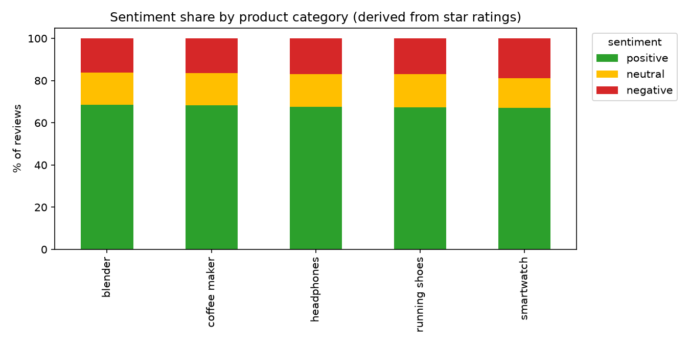
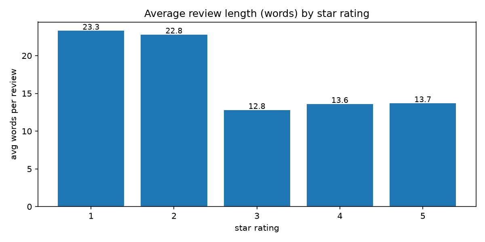
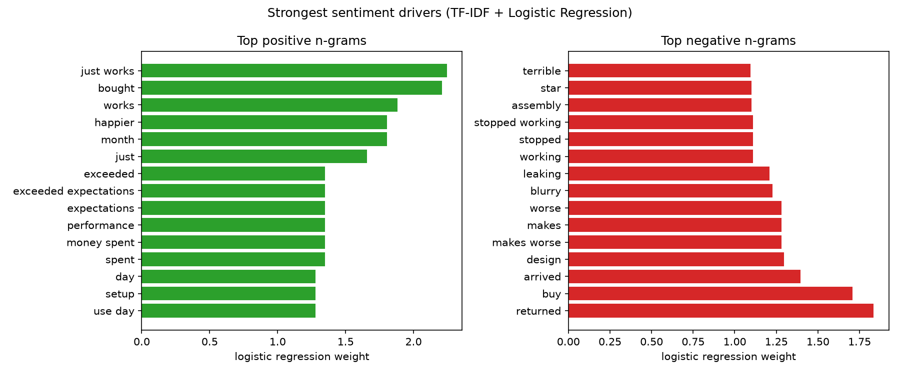
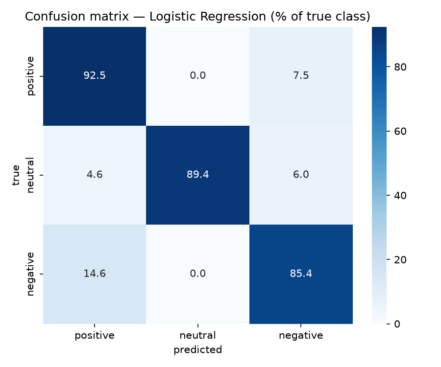

# Customer Sentiment & NLP Analysis

Analyze 5,000 customer reviews with NLP to quantify sentiment drivers — which themes customers praise, which they complain about, and where complaint volume concentrates by product category.

> **Portfolio project · synthetic data.** All reviews are programmatically generated (`src/generate_data.py`, seed 42). No real customers, products, or brands.

## Business Problem

Star ratings alone don't tell a product team *what* to fix. This project answers three questions from written review text:

1. What share of reviews is positive / neutral / negative per product category?
2. Which words and phrases most strongly drive positive vs negative sentiment?
3. Can a lightweight text classifier reliably flag negative reviews for triage?

## Dataset

`data/reviews.csv` — 5,000 synthetic reviews, Jan 2024 – Dec 2025 (see `data/README.md` for schema and generation details).

| fact | value |
|------|-------|
| reviews | 5,000 |
| product categories | 5 (smartwatch, running shoes, headphones, blender, coffee maker) |
| rating mix | 1★ 9.7% · 2★ 7.5% · 3★ 15.1% · 4★ 29.7% · 5★ 38.1% |
| derived sentiment | positive 67.8% · negative 17.1% · neutral 15.1% |
| label noise | ~8% of reviews use text that disagrees with the star rating (mimics real-world rating/text mismatch) |

Sentiment labels are **derived from star ratings** (1–2 = negative, 3 = neutral, 4–5 = positive) — there is no human-labeled gold set, so model metrics demonstrate the pipeline, not a production claim.

## Objectives

- Perform EDA: rating distribution, sentiment share by category, review length vs rating
- Build a reproducible text-cleaning pipeline
- Train and compare two TF-IDF text classifiers with stratified evaluation
- Extract interpretable sentiment drivers (top positive/negative n-grams) for stakeholder reporting
- Document the KPI layer a BI dashboard would expose

## Data Cleaning

`src/data_cleaning.py`:

1. Lowercase
2. Strip URLs
3. Remove non-alphabetic characters
4. Collapse whitespace
5. Drop English stopwords (scikit-learn's built-in list — no extra downloads)

Example: `"LOVE this!! The sound-quality is AMAZING..."` → `"love sound quality amazing"`

## SQL Analysis

`sql/analysis_queries.sql` (SQLite-compatible) covers the same questions in SQL:

- Average rating and review count by product category
- Sentiment share (% positive / neutral / negative) by category
- Rating distribution check
- Below-3.5 average-rating watchlist
- Negative-review volume by category × month (dashboard trend input)

## EDA

Key findings from `notebooks/analysis.ipynb`:

- **Rating skew:** 67.8% of reviews are positive (4–5★); negative is the minority class (17.1%) — per-class recall matters more than raw accuracy.
- **Complaints run longer:** 1★ reviews average **23.3 words** vs **13.7** for 5★ — unhappy customers explain themselves.
- **Category spread is narrow:** positive share ranges 64–68% across categories; headphones carry the highest negative share (~20%), a candidate for deeper review.




## Key Insights

1. **Negative reviews are longer and rarer** — triage tooling should weight recall on the negative class, not overall accuracy.
2. **Praise clusters on reliability language** — top positive drivers: *"just works", "exceeded expectations", "money well spent", "setup", "happier"*.
3. **Complaints cluster on defect + return language** — top negative drivers: *"returned", "do not buy", "stopped working", "leaking", "blurry", "terrible", "arrived"*.
4. **Ambiguity is realistic:** the ~8% rating/text mismatch (e.g. glowing text on a 2★ review) is exactly where both models err — the same place a human analyst would struggle.



## ML Methodology

Two scikit-learn pipelines on TF-IDF features (1–2 grams, `min_df=5`, `max_df=0.9`), stratified 80/20 split (`random_state=42`):

- **TF-IDF + Logistic Regression** (`max_iter=1000`)
- **TF-IDF + Multinomial Naive Bayes**

Results on the 1,000-review test set (executed run — see notebook):

| model | accuracy | macro F1 | positive F1 | neutral F1 | negative F1 |
|-------|----------|----------|-------------|------------|-------------|
| Logistic Regression | **0.908** | **0.886** | 0.938 | 0.944 | 0.775 |
| Multinomial NB | 0.893 | 0.863 | 0.927 | 0.869 | 0.793 |

Detailed per-class precision/recall:

| class (LogReg) | precision | recall | F1 | support |
|----------------|-----------|--------|----|---------|
| positive | 0.951 | 0.925 | 0.938 | 678 |
| neutral | 1.000 | 0.894 | 0.944 | 151 |
| negative | 0.709 | 0.854 | 0.775 | 171 |



**Reading the results:** both models separate the classes well; most errors are positive↔negative confusions caused by the deliberate rating/text mismatch noise — the honest hard case. Logistic Regression wins on accuracy and macro F1.

### Extensions (documented next steps — not implemented)

- **Fine-tune a transformer (e.g. BERT/RoBERTa)** and compare against these TF-IDF baselines — the natural next experiment, particularly for ambiguous reviews. Not done here: this repo intentionally stays on scikit-learn so it runs anywhere with no model downloads.
- Aspect-based sentiment: attribute praise/complaints to specific product features per category.
- Trend % negative per category over time as an early-warning KPI.

## Dashboard

KPI definitions a Power BI / Tableau dashboard would implement live in `dashboard/README.md`:

| KPI | definition |
|-----|-----------|
| Avg rating | `AVG(rating)` by category × month |
| % positive / % negative | rating ≥ 4 / ≤ 2 share by category × month |
| Review volume | `COUNT(review_id)` by category × month |
| Top complaint / praise themes | highest-weight n-grams from the logistic regression model |

## Results & Metrics

- 5,000-review synthetic corpus generated reproducibly (seed 42)
- Best model: **TF-IDF + Logistic Regression — 0.908 accuracy, 0.886 macro F1** on a stratified 1,000-review test set
- Negative-class recall 0.854 — the triage-relevant number for flagging unhappy customers
- 15 strongest positive and 15 strongest negative n-gram drivers extracted and charted

## Technologies Used

Python · pandas · NumPy · scikit-learn (TF-IDF, Logistic Regression, Naive Bayes) · matplotlib · seaborn · Jupyter · SQL (SQLite)

## How to Run

```bash
# 1. Install dependencies
pip install -r requirements.txt

# 2. Generate the synthetic dataset (seed 42, reproducible)
python src/generate_data.py

# 3. Run EDA summary
python src/analysis.py

# 4. Train & evaluate both models (prints classification reports)
python src/model.py

# 5. Execute the full narrative notebook (saves charts to images/)
jupyter nbconvert --to notebook --execute notebooks/analysis.ipynb --output analysis.ipynb --allow-errors
```

## Resume-Ready Description

> Built an end-to-end NLP pipeline on 5,000 synthetic customer reviews: text normalization, EDA, and TF-IDF classifiers (Logistic Regression vs Naive Bayes, stratified evaluation) reaching 0.91 accuracy / 0.89 macro F1, with interpretable n-gram analysis surfacing top praise and complaint themes by product category. Documented dashboard-ready KPI definitions and SQL analysis queries.
